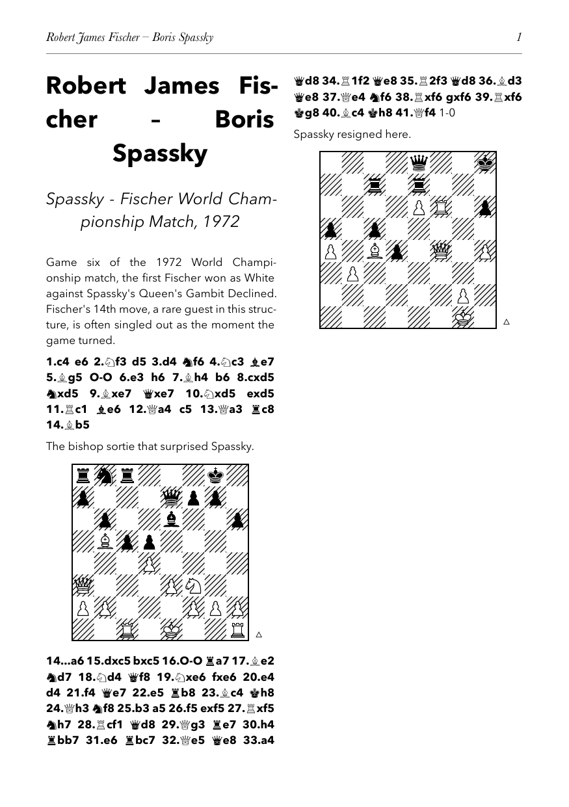

# caxton

Typeset annotated PGN chess games as print-ready, book-style pages — built on a vendored, modified copy of [`staunton`](https://github.com/ndg6/staunton) (see [Vendored engine](#vendored-engine)), so caxton is a single, self-contained Typst package with no external `@preview` dependency. Point it at a PGN and it renders figurine move notation with bold mainline moves, nested variations, NAGs and comments, diagrams placed exactly where the PGN marks them, and a title/subtitle read straight from the PGN's own tags. A PGN holding several games (the usual multi-game file layout) is typeset game by game, each starting on a fresh page with its own title, subtitle and running header. Named after William Caxton, who introduced printing to England.



## Quick start

```typ
#import "@local/caxton:0.1.0": caxton

#caxton(read("game.pgn"))
```

That's it for the common case — no configuration needed. See [Installing](#installing) for how to get the package onto your machine (it isn't on Typst Universe, only on GitHub, so `@preview/caxton` won't resolve).

## Diagram placement

Diagrams are placed exactly where the PGN itself marks them, using the two markers real chess software actually writes into PGN comments — not a fixed "every N moves" rule, and not staunton's own built-in marker set (which turns out to only partially match real-world practice — see [Why not staunton's own markers](#why-not-stauntons-own-markers)).

A diagram is inserted after a move whose comment contains either:

- **`[#]`** anywhere in the comment — the ChessBase / RPB Chessboard convention.
- **a comment that starts with `#`** — Scid's own documented rule.

The marker is stripped before the surrounding text is printed as prose, so it never shows up in the book. Either form can carry ordinary commentary alongside it — `{Some prose. [#]}` and `{# Some prose}` both work: the diagram is drawn, and "Some prose." is printed as a normal paragraph.

**If a game has no markers anywhere**, diagrams are placed automatically instead:

- In an **annotated** game, a diagram follows each heavily annotated mainline move (a comment of roughly a paragraph — 180+ characters), with no two diagrams closer than 6 plies (3 full moves) so dense commentary doesn't drown the page in boards.
- In a game with **no comments at all**, a diagram is drawn every 8 full moves.
- The **final position** always gets a diagram (an automatic one falling fewer than 6 plies before it is dropped in its favour), so output is never diagram-less.

Once a game has *any* real marker, placement becomes purely marker-driven — no automatic diagram is added anywhere else.

### Why not staunton's own markers?

`staunton`'s built-in `notation(diagrams: true)` recognises a bare `#`, an `#[caption]` form, `[d]`/`[D]`, and `\diagram`/`%%diagram`. Checked against ChessBase's, Scid's and RPB Chessboard's own documentation directly: only the bare `#` overlaps with a real convention (Scid's "comment starts with `#`"), and only by coincidence — Scid's actual rule is about the comment's leading character, not a marker anywhere inside it. `#[caption]`, a literal `[d]`/`[D]` bracket form, and `\diagram`/`%%diagram` could not be confirmed against any real tool's documentation or output. ChessBase's real marker — confirmed via RPB Chessboard's PGN syntax docs, which explicitly adopt "the same convention as ChessBase" — is `[#]` (bracket-hash-bracket), which staunton's own regex does not match correctly (it would strip the bare `#` but leave stray `[`/`]` behind).

There's also a correctness reason to reimplement this rather than call `notation(diagrams: true)` directly: staunton concatenates a move's own trailing comment into the *same string* as the move before bolding it, so a marker (and any prose beside it) on a mainline move would get bolded along with the move itself. `caxton` blanks that one comment before rendering and prints the cleaned prose separately, at normal weight — see the comments in `lib.typ` for the full explanation.

## API

```typ
#caxton(
  pgn,                    // required: PGN text (string, or a ```raw block```); may hold several games
  title: auto,             // auto: "White -- Black" from each game's tags; content; none
  subtitle: auto,           // auto: "Event, Year" from each game's tags; content; none
  auto-strip-empty-title-fields: true,  // drop blank/"?" White, Black, or Event tags from auto title/subtitle
  paper: "a5",
  columns: 2,
  margin: auto,             // auto: proportioned for the default A5/2-column layout
  board-size: 46mm,         // tuned for the default layout; widen if you change paper/columns
  board-color-theme: color-theme(light: white, dark: white, pattern: "stripes"),
  board-labels: false,
  board-border: 1pt + black,
  font: ("Avenir Next", "Arial Unicode MS"),
  text-size: 8.3pt,
  leading: 0.68em,
  header-font: "Baskerville",
  to-move-marker: true,      // small triangle outside each diagram's corner
  marker-gap: auto,          // auto: board-size / 8 / 1.5
)
```

With a multi-game PGN, each game starts on a fresh page; `title`/`subtitle` left as `auto` resolve from each game's own tags, while an explicit value applies to every game.

Every field is overridable. The defaults reproduce the two-column A5, diagonally-hatched "old chess book" look this package started as; nothing about the layout is hardcoded beyond those defaults. `board-color-theme` takes any `staunton` `color-theme(..)` value — e.g. a normal green/cream board:

```typ
#import "@local/caxton:0.1.0": caxton, color-theme
#caxton(read("game.pgn"), board-color-theme: color-theme("wikipedia"), board-labels: true)
```

### Fonts

No fonts ship with the package (Typst packages can't bundle fonts) — the defaults only *name* system fonts, and all three (`Avenir Next`, `Arial Unicode MS`, `Baskerville`) are macOS system fonts. On other platforms Typst warns about the unknown families and silently falls back, which usually still compiles but not with the intended look.

`font` needs a fallback covering the Unicode chess-figurine block (U+2654–U+265F) for pieces to render instead of tofu boxes — on macOS, `"Arial Unicode MS"` and `"Apple Symbols"` both work; the former is noticeably better-weighted and baseline-aligned against most body fonts.

**On Linux**, a close all-free substitute stack is Montserrat (for Avenir Next), DejaVu Sans (its chess glyphs are well-drawn and cover the figurine block), and Libre Baskerville:

```typ
#caxton(read("game.pgn"),
  font: ("Montserrat", "DejaVu Sans"),
  header-font: "Libre Baskerville")
```

On Arch, `pacman -S ttf-montserrat ttf-dejavu` covers the first two; Libre Baskerville can be dropped into `~/.local/share/fonts` from [its upstream repo](https://github.com/impallari/Libre-Baskerville) (OFL-licensed, as is Montserrat). Debian/Ubuntu equivalents: `fonts-montserrat`, `fonts-dejavu`. If no figurine-capable font is installed at all, `gnu-free-fonts`' FreeSerif also covers the block, at some cost in glyph weight.

`to-move-marker` is purely decorative (an echo of the small side-to-move triangle printed in some older chess books) — it does not indicate which side is actually to move.

## Installing

Not on Typst Universe — clone this repo into Typst's local package directory:

```sh
git clone https://github.com/obazin/caxton.git \
  "$(typst --version >/dev/null 2>&1 && echo "$HOME/Library/Application Support/typst/packages/local/caxton/0.1.0")"
```

(On Linux, the local package directory is `$HOME/.local/share/typst/packages/local/`; on Windows, `%APPDATA%\typst\packages\local\`.) Then `#import "@local/caxton:0.1.0": caxton` as above.

Alternatively, copy this whole repo (not just `lib.typ` — it needs its `vendor/` directory alongside it) into your project and `#import "lib.typ": caxton` by relative path. Either way, caxton pulls in nothing from Typst Universe or any other package registry: it's fully self-contained.

## Vendored engine

`vendor/staunton/` is a snapshot of a modified fork of `staunton` — the chess
engine and board/notation rendering caxton is built on — folded directly
into this package rather than resolved as an external dependency, so caxton
has no `@preview`/`@local` imports at all. The one change from upstream
`staunton`: standard-chess mainline resolution (the hot path a diagram-heavy
document spends nearly all its compile time in) runs through a bundled Rust
WASM plugin (`vendor/staunton/src/assets/engine/shakmaty.wasm`, built from
the `shakmaty` crate) instead of a pure-Typst move generator — roughly an
order of magnitude faster end-to-end on a real, diagram-heavy multi-game PGN,
with byte-for-byte identical output. See `vendor/staunton/NOTICE.md` for
exactly what's vendored, where from, and — important — **an unresolved
licensing question about the bundled WASM plugin that should be settled
before this package is ever published or distributed.**

## Development

`tests/` holds caxton's own unit test suite — plain `.typ` files, each one an independent `typst compile`, asserted with `#assert(..)` (Typst has no built-in test framework, but nothing stops a package from using its own `assert`/`panic` this way; this follows the same convention as the vendored `staunton` fork's own `tests/`). Most tests import caxton's private (underscore-prefixed) helpers directly — `#import "/lib.typ": _diagram-points, ...` — since Typst doesn't enforce real module-level visibility, so the actual decision logic (diagram placement, title auto-detection, PGN splitting) is asserted on directly rather than only inferred from rendered output; a handful of true end-to-end tests (`multi_game_e2e/`, `zero_move/end_to_end.typ`, `null_move/`, `percent_escape_e2e/`) compile a full `#caxton(..)` call to catch integration-level regressions.

```sh
bash tests/run.sh              # run everything
bash tests/run.sh tests/title  # run just one directory
```

A file with a `// EXPECT: <substr>` header is an expected-FAIL test (must error, with that substring in the message); every other file is expected-PASS (must compile). Output PDFs land under `tests/out/` (gitignored) for eyeballing if needed.

## License

MIT for caxton's own code — see [LICENSE](LICENSE). The bundled example PGN
(`examples/fischer_spassky_1972_g6.pgn`) is a bare game score with two short
annotations written for this package; it carries no third-party commentary.
The vendored engine under `vendor/staunton/` carries its own, different
licensing — see [Vendored engine](#vendored-engine) above and
`vendor/staunton/NOTICE.md` before treating this repository as simply MIT.
